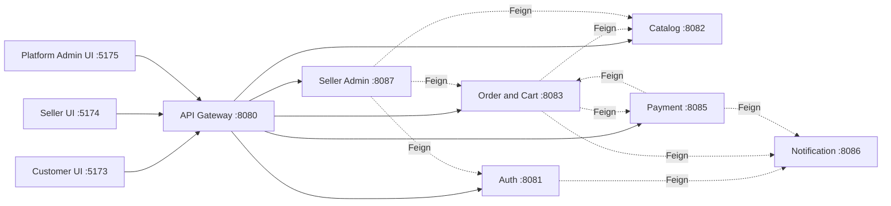

# ecom-microservices-spring-boot

A multi-vendor eCommerce platform built using a microservices architecture 
with Spring Boot. The system is broken into independently deployable 
services — Auth, Catalog, Order (Cart + Coupons), Payment, Seller & Admin, 
and Notification — each with its own database, communicating via REST 
APIs and routed through a Spring Cloud Gateway.

## Tech Stack
- Java 17, Spring Boot 3.x
- Spring Data JPA, MySQL
- Spring Security + JWT
- Spring Cloud Gateway, OpenFeign
- Razorpay & Stripe integration

## Architecture

All browser traffic enters through the API Gateway on port **8080**. The gateway
validates the JWT, forwards the caller's identity (`X-User-Id`, `X-User-Role`)
and a per-request `X-Correlation-Id` to the downstream service.

## Services and ports

| Service | Port | Database | Gateway routes |
|---|---|---|---|
| api-gateway | 8080 | none | entry point |
| auth-service | 8081 | `auth_service_db` | `/api/auth/**`, `/api/admin/**`, `/uploads/avatars/**` |
| catalog-service | 8082 | `catalog_db` | `/api/products/**`, `/api/wishlist/**`, `/api/categories/**`, `/uploads/**` |
| order-service | 8083 | `order_db` | `/api/orders/**`, `/api/cart/**` |
| payment-service | 8085 | `payment_db` | `/api/payments/**` |
| notification-service | 8086 | `notification_service_db` | not routed |
| seller-admin-service | 8087 | `seller_admin_db` | `/api/seller/**` |

| UI | Port |
|---|---|
| `frontend` (customer) | 5173 |
| `seller-admin-ui` | 5174 |
| `platform-admin-ui` | 5175 |

## Running locally

Prerequisites: Java 17, Maven, MySQL on `localhost:3306`, Node.js 18+.

1. Create a `.env` file with `JWT_SECRET=<your secret>` in each service that
   validates tokens (the gateway and auth-service use the same secret).
2. Start each backend service from its folder with `mvn spring-boot:run`
   (databases are created automatically).
3. Start a UI from its folder with `npm install` and `npm run dev`.

## Tracing a request

Every response carries an `X-Correlation-Id` header, and the gateway logs it on
every line. Send your own `X-Correlation-Id` (8-64 characters of letters,
digits, `.`, `_`, `-`) to follow a request end to end; invalid values are
replaced with a generated UUID.
